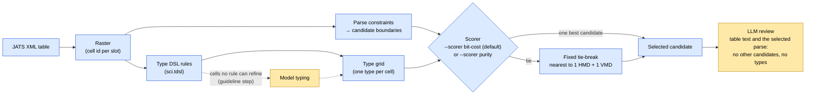
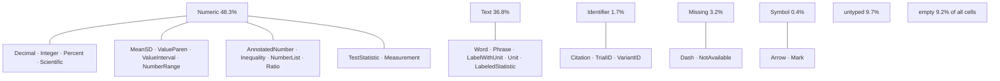

# Type inference for table disambiguation: summary

## 1. The idea

The parse constraints (`dataset-builder-agent/src/parse_constraints.pl`)
propose candidate boundaries for each table: how many header rows (HMD), how
many row-header columns (VMD), which rows are set aside as separators, and
whether the table splits into subtables. They look only at the structure
(merged cells), never at the text, so many tables get several candidates and
a language model has to choose.

The hypothesis is that a **type abstraction** of the table, with every cell's
text replaced by an inferred type, carries enough signal to make that choice
without a model call. Headers tend to be text, data tends to be numbers of a
consistent format, and the boundary between them is where the type changes.



Blue steps are deterministic Prolog; yellow steps involve a model.

## 2. How a cell gets its type

The rules are written in the type DSL (`type_dsl_grammar.txt`), compiled by
`type_dsl_engine.pl`, and applied by `table_type_abstraction.pl`:

1. **Normalise** the cell text: trim it and collapse runs of white space.
   (Superscripts arrive already flattened, so `10⁻⁵` reads `10 −5`.)
2. **Empty** text is typed `empty`; synthetic padding cells too.
3. **Run every rule.** Each `if regex "…" decide T` must match the *whole*
   text. The result is the list of all rules that matched.
4. **Pick one type.** No match gives `untyped`. Otherwise:
   - drop every matched type that is a supertype of another matched type
     (so `Integer` beats `Numeric`);
   - of the rest, the rule written **first in the file wins**. Rule order is
     therefore the precedence between unrelated types.
5. **Family** = the root reached by following the first declared supertype
   (`MeanSD <: Numeric`, so its family is `Numeric`).

Typing is **context-free**: a cell's type depends only on its own text,
never on its position or neighbours. `2018` is an `Integer` whether it is a
data value or a year in the header. This makes the abstraction cheap,
cacheable and deterministic, and is also its main limitation (§6).

A merged cell is typed once; its type fills every slot it covers.

## 3. The current rules (`dataset-builder-agent/type_dsl_examples/sci.tdsl`)

31 rules, written from the cells of the **dev** split only, in five
families. Counts are over all 124,039 cells of both datasets (first dataset:
50 papers, 162 tables; complex dataset: 248 papers, 1,091 tables).



Rule sections, in file (precedence) order:

| Section | Types (cells) | Examples |
|---|---|---|
| Numeric | Decimal (14,582), Integer (9,642), ValueParen (7,837), MeanSD (7,608), ValueInterval (4,751), AnnotatedNumber (4,692), Inequality (1,626), NumberRange (1,263), NumberList (1,047), Percent (585), Scientific (377), Measurement (341), TestStatistic (330), Ratio (171) | `0.47`, `123 (40.7%)`, `3.59 ± 0.06ab`, `18.10 [18.04, 18.15]`, `<0.001`, `0.36–0.58`, `4.1 × 10 −5`, `P = 0.004` |
| Missing | NotAvailable (1,897), Dash (1,790) | `NR`, `NA`, `–` |
| Symbol | Mark (396), Arrow (9) | `**`, `↑↑` |
| Identifier | Citation (1,856), TrialID (53), VariantID (13) | `Weiss RJ 2007 [ 25 ]`, `NCT01193101`, `rs1882694 (AC/CC vs. AA)` |
| Text | Phrase (22,076), Word (14,118), LabelWithUnit (5,429), Unit (87), LabeledStatistic (33) | `Study design`, `Region`, `Age (years)`, `(mmHg)`, `DLB vs AD, P = 0.03` |

Numeric sections come first, then Missing and Symbol, then Identifier, then
Text, so that, for example, `NR` is `NotAvailable` rather than `Word`, and
`Sawada et al. (2019)` is a `Citation` rather than a `Phrase`.

### Insights into the rules

- **Coverage.** 9.7% of non-empty cells are untyped (2.1% on the first
  dataset's dev split, where the rules were written; 7.9% on its test split;
  11.7% on the complex tables). The commonest gaps are concrete and fixable:
  regression reference cells (`1.00 (Reference)`, `1 (ref)`), GRADE
  certainty ratings (`⊕⊝⊝⊝ VERY LOW`), bullet-prefixed labels (`▪FISH`),
  p-values with stars (`< 0.001 ***`), reference numbers alone (`[ 51 ]`), the
  Unicode hyphen `‐` (not in the Dash class), and long quoted text.
- **Most cells are unambiguous.** On the first dataset, about 74% of
  non-empty cells match exactly one rule, 17% match several rules of the same
  family (resolved by the subtype order), and about **3% match rules from
  different families**. Those are decided by
  rule order alone, a modelling choice the DSL does not make explicit.
  Example: `6.49ab` matches AnnotatedNumber, Measurement and Phrase.
- **Known precision problems.**
  - `AnnotatedNumber` (a number followed by significance letters) also
    catches labels such as `3A`, `3B`.
  - `Measurement` reads short letter suffixes as units, so `12W` (12 weeks)
    is a measurement and `6.49ab` would be one if AnnotatedNumber did not
    come first.
  - Headers that look like data (`2018`, `50`, `100` as dose levels) are
    typed Numeric, the main way types point the wrong way.
- **Text subtypes carry little signal.** Word vs Phrase vs LabelWithUnit is a
  difference of form, not role; at the family level they are all Text. The
  role that matters (is this a variable label, a group level, or the name of
  an entity such as a study?) is not visible in the string, which is what the
  guideline step (§9) is meant to supply.
- **Identifier is the one role rules can see.** Citations and registry ids
  have a fixed form, so they are typed by rule. Under the labelling
  convention adopted in the review (a column naming each row's entity is
  data, not a row header), this is the type that most directly informs the
  VMD decision.

## 4. Purity

Purity asks: **does the candidate make the data region uniform?**

For one candidate, take each data column `j` and count its cells by type,
leaving out empty, Missing and untyped cells (they say nothing about the
column's type). With `n(j,t)` the number of cells of type `t` in column `j`:

```
purity(j)        = max_t n(j,t) / Σ_t n(j,t)
column purity    = mean over data columns j of purity(j)
row purity       = the same over data rows
```

Each merged cell is counted once per line it lies on. A purity of 1 means
every data column (row) holds a single type.

**How it was measured (Phase 0).** For each labelled table, purity of the
correct candidate was compared with every other boundary the geometry
allows (up to 4 header rows × 3 row-header columns, excluding boundaries that
cut a merged cell). Reported: mean purity, and the share of tables where the
correct boundary is *strictly* the purest or *tied* for purest.

**Result: purity saturates.**

| Dataset (level) | Correct boundary, column purity | Other boundaries | Strictly purest | Tied |
|---|---|---|---|---|
| First test split (family) | 0.993 | 0.974 | 10% | 83% |
| Complex test (family) | 0.985 | 0.933 | 30% | 63% |

Purity can only detect *too little* metadata (a text header left in a
numeric column). It cannot detect *too much*:

- moving a numeric data column into the row headers leaves every remaining
  column pure;
- leaving a text row-header column in the data adds one more perfectly pure
  (all-Text) column.

So the correct boundary is almost always among the purest, but rarely the
only one.

## 5. Contrast

Contrast asks: **is each header cell different from the data it labels?**

For each data column `j`, its **heading** is the lowest HMD cell above it;
for each data row `i`, its heading is the rightmost VMD cell to its left. Let
`mode(j)` be the most common type of the column's typed data cells. Then

```
differs(j)       = 1 if type(heading(j)) ≠ mode(j), else 0
column contrast  = Σ_j differs(j) / number of columns with a typed heading
row contrast     = the same over data rows and their VMD headings
```

Lines with no heading, an untyped/empty heading, or no typed data are
skipped.

Contrast detects exactly what purity misses: **too much metadata**. A data
row moved into the header puts numbers in heading position over numbers, and
a numeric column moved into the row headers does the same for rows.

**Result.** At the family level the heading differs from its column in
54–60% of columns and from its row in 56–76% of rows; at the fine type level
70–83% and 74–93%. It is not near 100% because text data columns usually sit
under text headers: in 44 of the 128 correct complex-table data regions the
data is mostly Text, where contrast has nothing to work with.

### Worked example (PMC1361785, table 0)

A "Variable | Hypertensives | Controls | P value" table: one header row, one
row-header column of text, numeric data. Family-level type grid:

```
Text | Text    | Text    | Text
Text | Numeric | Numeric | Numeric
Text | Numeric | Numeric | empty
Text | Numeric | Numeric | Numeric
…
```

| Boundary | Column purity | Row purity | Columns whose heading differs | Rows whose heading differs |
|---|---|---|---|---|
| 0 HMD, 1 VMD | 0.88 | 1.00 | 0/0 | 10/11 |
| 1 HMD, 0 VMD | 1.00 | 0.71 | 3/4 | 0/0 |
| **1 HMD, 1 VMD (correct)** | **1.00** | **1.00** | **3/3** | **10/10** |
| 1 HMD, 2 VMD | 1.00 | 1.00 | 2/2 | 0/10 |
| 2 HMD, 1 VMD | 1.00 | 1.00 | 0/3 | 9/9 |

Purity rules out the first two boundaries but ties the last three. Contrast
separates them: only the correct boundary has every heading differ from its
data. In an all-text table, by contrast, every boundary scores purity 1 and
contrast 0, and there is no type signal at all.

## 6. The scorer

The scorer in use (`src/table_type_scorer.pl`, `--scorer bit-cost`, the default)
combines both ideas into one number, a **description length**: how many bits it takes to write down the type grid
if each region has its own type distribution. Lower is better.

For each subtable of a candidate:

- **Data:** every data column and every data row has its own distribution;
  a line of `n` typed cells costs `n · H` bits (`H` the entropy of its
  types). The data cost is the mean of the column view and the row view.
  Mixed lines (impure) cost bits, which is the purity idea.
- **Headers:** all HMD cells of the subtable share one distribution, and so
  do all VMD cells. Putting numbers into a text header region mixes it and
  costs bits, which is the contrast idea.
- **Model cost:** each distribution used costs `½·log₂ N` bits (BIC; `N` =
  typed cells). Without it, splitting a table into more subtables could only
  lower the cost, and spurious subtable candidates won.
- **Identifier role:** Identifier cells (citations, trial and variant ids)
  are data by role. They are left out of the row distributions, and each one
  a candidate places in a row-header column costs `½·log₂ N` bits.

The candidate with the lowest cost is selected. If two or more tie, the tie is
broken without types: nearest to one HMD row and one VMD column, then fewest
subtables, then candidate id (`selected_by` records it). The margin to the runner-up (bits per typed cell) is a
confidence measure. `--scorer purity` selects by purity (§4) instead.

Types are compared by family. `src/type_inference.pl --level=group` compares
them by group instead: the type just below the family, if it has subtypes of
its own, else the family. A program can so split `Text` into intermediate
types while `Numeric`, whose subtypes are all leaves, stays one group. The
default is unchanged until group scoring has been evaluated on dev.

The selection, in `papers/PMC<id>/type_inference.jsonl`, is what the review
checks: the model sees the table with its text and the selected parse, never
the other candidates or the types. It confirms the parse or gives its own
(H, V), which Prolog matches to a candidate. Types do not reach the model, and
the certificates do not use them yet.

A variant that added explicit schema summaries (per-column unions of types)
and the contrast count as separate terms was tried and removed: it did not
improve the test result, and the column schema is blind to a row-header
column taken as data.

## 7. Results

**Type–region dependence (Phase 0).** Mutual information between cell type
and gold region, against a permutation baseline that shuffles regions within
each table:

| Dataset | Family | Fine types | Permutation max |
|---|---|---|---|
| First test split (98 tables, provisional labels) | 0.184 bits (18.6% of region entropy) | 0.240 | 0.004 |
| Complex test (150 tables, human-reviewed) | 0.171 bits (16.6%) | 0.210 | 0.008 |

Data cells are about 45–57% Numeric and 31% Text; header cells about 78–86%
Text. The dependence is real but far from deterministic.

**Choosing a candidate (Phase 1), complex test sample**, 150 tables
(human-reviewed labels; 128 have a correct candidate):

| Scorer | Subtables (35) | Separator rows (57) | Multi-level (58) | All |
|---|---|---|---|---|
| Description length, as first specified (family) | 1 | 30 | 36 | 67 |
| + model cost (post-hoc fix) | 11 | 37 | 48 | 96 |
| + identifier role (chosen on dev, run once) | 12 | 39 | 46 | **97** |
| Always 1 HMD + 1 VMD | 3 | 37 | 30 | 70 |
| Random candidate (expected) | 3.0 | 21.2 | 26.2 | 50.3 |

The dev-selected scorer beats the fixed (1, 1) choice with McNemar exact
p = 0.0002 (right on 39 tables where the fixed choice is wrong, wrong on 12
where it is right). It decides 138 tables; ranked by margin, its 25, 50 and
75 most confident decisions are 76%, 80% and 83% correct, so on this sample
the margin is only a weak confidence signal (for the model-cost scorer
without the identifier role the top 25 and 50 were 92% and 88%). On the 80
dev tables it scores
48/80, against 43 without the identifier role and 28 for the fixed choice.

On the first, mostly simple dataset (provisional labels that follow the
opposite row-header convention), the fixed (1, 1) choice is better: 77/98
against 57–72 for the scorer variants. Types help most where structure is
complex: multi-level headers (48 vs 30) and subtables (12 vs 3).

## 8. Limits and open problems

1. **Candidate generation, not scoring, caps accuracy.** 22 of the 150
   complex test tables have no correct candidate (15 of 35 in the subtables
   class): row-header columns that no layout candidate offers, spurious
   splits at empty spacer columns, and side-by-side blocks that are never
   split.
2. **Roles are not forms.** Whether a text column is a row header or data
   depends on meaning (a list of variables vs a list of studies), which
   context-free regex types cannot express beyond identifiers.
3. **Text-only tables** (about a third of data regions) give the types
   nothing to work with; the scorer ties and the tie-break decides, or it
   decides on noise.
4. **Label consistency.** Five test tables label a citation column as a row
   header, against the convention used elsewhere; these alone account for
   the identifier role's failures on test.
5. **Rule precision and coverage** (§3): about 10% untyped cells and a few
   systematic false positives.

## 9. The guideline step

Part of the pipeline, but not yet run with a real model: `run_agent.sh` runs
`guideline_agent.sh` after the build (`--no-guidelines` skips it), which runs
`src/guideline_steps.pl`, `src/type_guidelines.pl`,
`src/guideline_answers.pl` and `src/type_guidelines.dml`. The scorer reads
`guided_types.jsonl` when it exists, and `types.jsonl` otherwise.
A cell is sent to a model only when no rule types
it, or when its rule type has guideline-decided subtypes (in `sci.tdsl`:
Word, Phrase and LabelWithUnit may become VariableLabel, CategoryLevel,
EntityName, StatisticLabel or Description). Every other rule type is final,
so deterministic naming systems never reach the model. Answers are checked
against each cell's allowed types and cached by (program hash, text, rule
type). Estimated cost for the 125 labelled papers: about 1.6M to 3.4M input
tokens, depending on whether the model finishes in one turn or two.

`type_dsl_examples/sci_text.tdsl` is an alternative program, not yet the
default or evaluated. It keeps the rules of `sci.tdsl` for Numeric, Missing,
Symbol and Identifier, extended for numeric forms that used to fall through
to text, and of the text rules keeps only `Unit`, followed by a fallback
that types anything with a letter as `Text`. Thirteen guideline types below
`Text` decide the rest, in four groups: MetadataText, CategoricalValue,
EntityText and QualitativeData. A type may have a rule and a guideline both:
`Unit`'s rule is final when it matches, and any other `Text` cell may still
be given `Unit` by its guideline. Use it with `--program` on
`guideline_agent.sh` and `src/type_inference.pl`, with `--level=group` so
that the groups reach the scorer.

## 10. Where things are

| What | Where |
|---|---|
| DSL grammar, engine, parser | `type_dsl_grammar.txt`, `src/type_dsl_engine.pl`, `src/type_dsl_parser.pl` |
| Rule program | `dataset-builder-agent/type_dsl_examples/sci.tdsl` |
| Guideline step | `guideline_agent.sh`, `src/guideline_steps.pl`, `src/type_guidelines.pl`, `src/guideline_answers.pl`, `src/type_guidelines.dml` |
| Type abstraction of tables | `src/table_type_abstraction.pl` |
| Scorer and its command line | `src/table_type_scorer.pl`, `src/type_inference.pl` |
| Review prompts | `src/table_review.pl` |
| Phase 0 (dependence, purity, contrast) | `tools/type_region_phase0.py` |
| Experiment scorer and gold evaluation (not run by the pipeline) | `dataset-builder-agent/experiments/type_abstraction/type_candidate_scorer.py` |
| Labels, splits, results, reproduce steps | `dataset-builder-agent/experiments/type_abstraction/README.md` |
